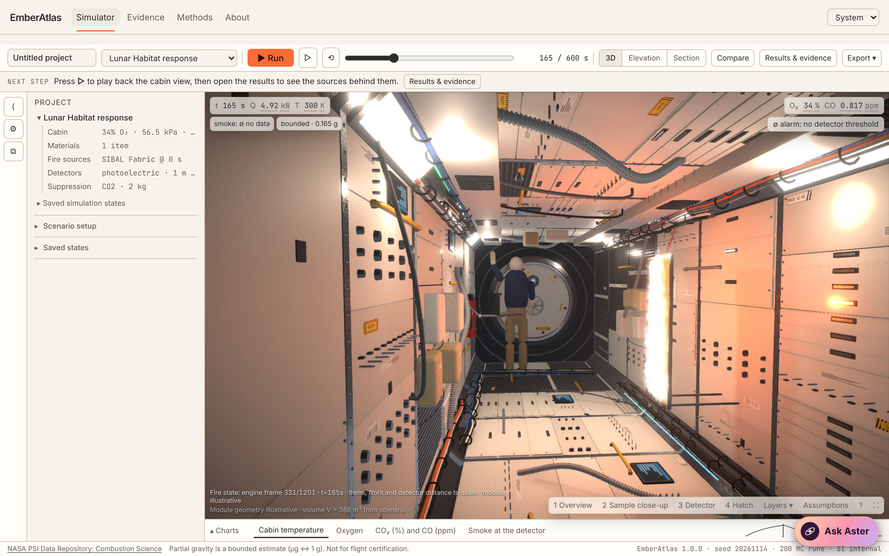
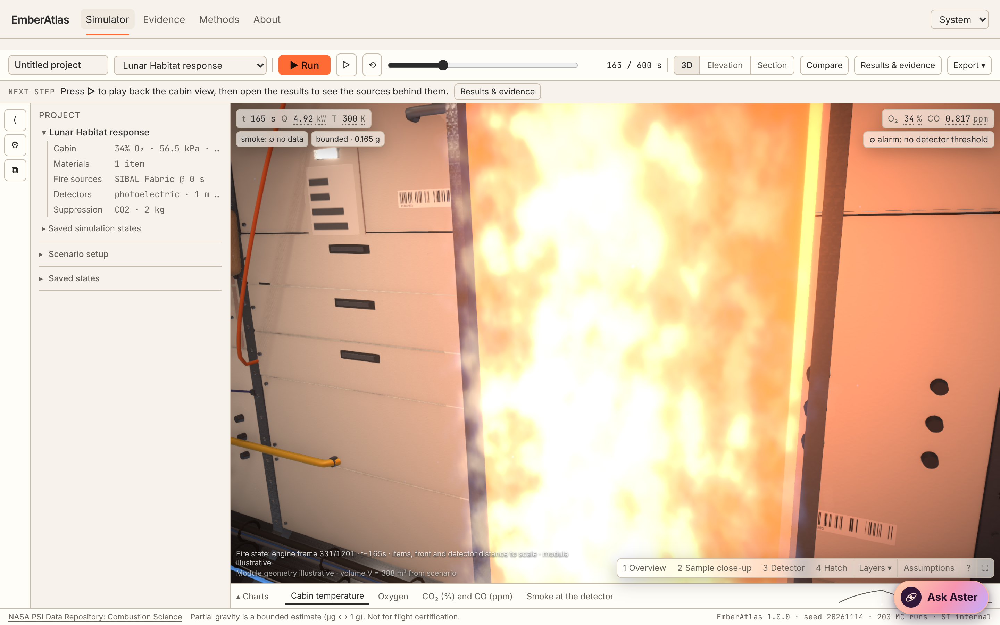

# EmberAtlas: will it burn on the Moon?
EmberAtlas shows what NASA's ISS fire experiments prove about cabin materials, where that proof stops, and simulates what lies beyond, so the next test is the right one. NASA Space Apps 2026 · Flame in Freefall.

**Findings** (all computed from `web/data`, shown on `/` and `/evidence`): 1. **Earth test vs orbit:** in SAFFIRE-II (PSI-99) like-for-like samples, none burned worse in orbit than in the 1 g test (currently 7 samples: 4 less flammable, 3 the same; small n). 2. **Where the evidence stops:** no solid in PSI was burned above 22.2% O₂ (`web/data/materials.json`); a lunar habitat breathes 34% at 56.5 kPa. ACME BRE (PSI-20) is the only flight data at exploration atmospheres, and it is a gas burner emulating solids. 3. **Beyond it:** the simulator runs the lunar cabin; every out-of-envelope result carries an EXTRAPOLATED badge and the app proposes the next test to fly.

**Simulator (3D):** the cabin view is a procedural, illustrative lab-module interior in which every fire-related visual (flame, char, fire light, smoke, alarm, fan, agent) is driven only by the engine frame via `web/components/sim/scene3d/frame.ts`; Elevation and Section remain as the 2D schematic, and the SVG is the fallback without WebGL. Keys: R run · C charts · F fullscreen · 1–4 camera presets · `?present=1` for a chrome-less demo run.

  

**Routes:** `/` story · `/simulator` (presets: Saffire replay; Same fabric: ISS vs Lunar Habitat; Lunar Habitat: tune the response) · `/evidence` (Earth vs orbit, where the evidence stops, mission-to-experiment match) · `/methods` · `/about`.

**Run:** `pnpm -C web install` · `pnpm -C web dev` · `pnpm -C web test` · `pnpm -C web build`. Set `OPENAI_API_KEY` as a server-side env var (never `NEXT_PUBLIC_`, never committed); without it the AI panels say so and everything else works.

**Data:** 2,818 PSI table rows with accession + file + line provenance from 18 accessions (`web/data/psi/tables_index.json`): PSI-10 327 · PSI-20 18 · PSI-22 32 · PSI-23 18 · PSI-25 129 · PSI-26 122 · PSI-39 87 · PSI-47 2 · PSI-68 8 · PSI-69 274 · PSI-98/99/100 13 · PSI-101 109 · PSI-102 8 · PSI-107 469 · PSI-142 8 · PSI-159 1,194. Plus PSI-100 Saffire-III cabin telemetry for the replay.

**Validation (honest, one line each):**
- FLEX cross-check (PSI-69 table vs NASA/TP-2015-216046): 0 mismatches in 1,533 values (`web/data/psi/flex_crosscheck.json`).
- Held-out FLEX burning-rate constant K: MAPE 13.3%, n = 66 (`web/data/validation/droplet_K.json`).
- Flame spread on held-out SIBAL (Saffire-III): 29.3% error, n = 1 (`web/data/params/spread.json`). One training sample, one test sample.
- Saffire replay is a cabin-scale sanity check only (T RMSE ~6 K, P MAPE ~0.2%): a sample-size fire barely changes the cabin; it does not test flame-spread physics.

**Limitations:** one well-mixed cabin zone; 1D spread per item; partial gravity is bounded between µg and 1 g, never measured; cabin heat loss and smoke are theory-only; small n everywhere. Not for flight certification. Details: `/methods#limitations`, `docs/VALIDATION.md`.

**Use of AI:** Claude Code (Anthropic) wrote the code under human direction and review. At runtime the OpenAI API powers the scenario builder, run interpretation and the experiment-match explanation, grounded on engine output and PSI rows, with a numeric guard (`web/lib/ai/guard.ts`). No AI-generated images.

**Docs:** `docs/SUBMISSION.md` · `docs/PITCH.md` · `docs/STATUS.md` · `docs/VALIDATION.md` · `CREDITS.md`. **License:** MIT (`LICENSE`).
