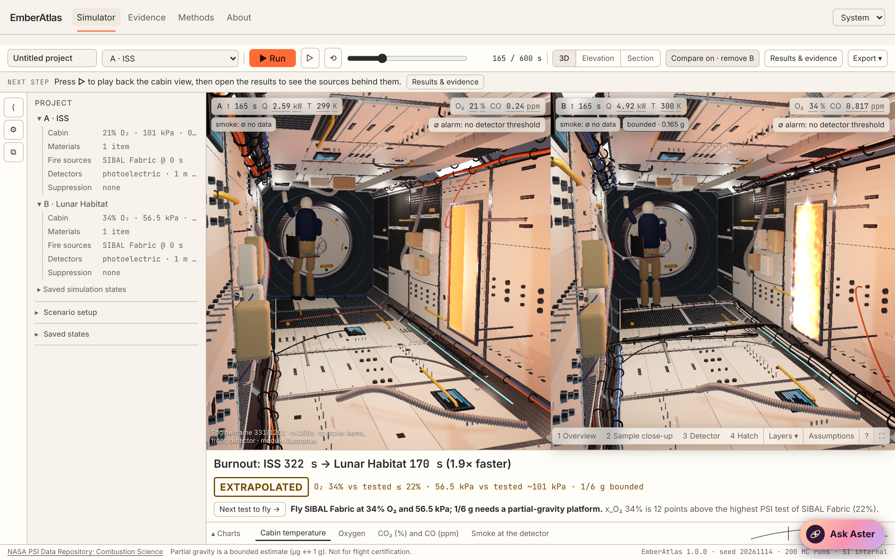

# EmberAtlas: the firefighter for space

**Describe a spacecraft cabin, burn it with a physics engine calibrated on NASA fire experiments, ask Aster (the AI fire engineer) why, and fix it before launch.**
NASA Space Apps 2026 · challenge: [Flame in Freefall](https://www.spaceappschallenge.org/) · Team EmberAtlas, Toronto.

- **Live app:** https://emberatlas-five.vercel.app
- **Demo video:** TODO_VIDEO_URL
- **One-click demo:** `/simulator?preset=iss-vs-lunar&run=1`



## The problem
Fire behaves differently in microgravity: no buoyancy, so flames depend on airflow, and the 1 g tests used to qualify materials do not always predict orbit. Lunar habitats will breathe an exploration atmosphere (34 % O₂ at 56.5 kPa, NTRS 20240003211) where **no solid in NASA's PSI repository has been burned** (highest tested solid O₂: 22.2 %), and at 1/6 g, where NASA's FM2 tests show some materials burn more readily than at either µg or 1 g. Designers need to see where a cabin fire would start, how it would end, and where the evidence stops.

## What it does (4 steps)
1. **Describe:** pick a preset or describe the cabin in words; *Build with AI* drafts the scenario from NASA atmospheres and PSI-tested materials only and flags every assumption.
2. **Burn with NASA data:** a cabin fire engine (one well-mixed zone, 1-D flame front per item, Monte Carlo bands) runs it in 3D. Every result outside the tested PSI envelope carries an **EXTRAPOLATED** badge.
3. **Ask Aster:** answers from the engine's own numbers and the NASA records, with citations; a numeric guard removes any number not in the tool output and shows how many were checked.
4. **Fix before launch:** a deterministic design review ranks fixes you can apply and re-run, then names the next test to fly.

**Demo result** (`pnpm -C web exec tsx scripts/engine-check.ts`, see `docs/DEMO_SCRIPT.md`): the same SAFFIRE SIBAL fabric with the same crew response (detect at 30 s, fan off, 2 kg CO₂ 30 s later; design inputs). **ISS:** the fire goes out at 30 s when the fan stops. **Moon base:** it burns the whole sample by 171 s; peak heat 4 900 W vs 2 580 W. Ranked fixes on the unfixed Moon cabin: give the extinguisher an alarm path; test SIBAL at 34 % O₂ (it was tested only to 22.1 %); lower cabin O₂ to 29.2 % (peak 4 920 W → 4 040 W).

## How NASA data is used
- **2,818 PSI table rows from 18 accessions** (`web/data/psi/tables_index.json`), each with accession + file + line and the raw cell string; ambiguous cells are flagged, never filled. The full list with titles, DOIs and what each is used for is on `/evidence#psi-datasets` and `/credits`.
- Key datasets: BASS / BASS-II (PSI-26, PSI-25) tested envelopes; SAFFIRE-I/II/III (PSI-98/99/100) spread calibration, held-out test, Earth-vs-orbit and the Saffire-III cabin replay; FLEX (PSI-69, cross-checked against NASA/TP-2015-216046) droplet burning rates; ACME BRE (PSI-20) for exploration atmospheres; SAME / SAME-R / DAFT (PSI-102/101/47) smoke evidence.
- Outside PSI (labelled so): FM2 (NTRS 20240015307) and LUCI (NTRS 20250010653) for partial gravity.

## How the physics works (short)
Opposed-flow flame spread (de Ris thin-fuel form, calibrated on one SAFFIRE sample), droplet d²-law burning (fit on FLEX), oxygen-consumption heat release, agent dilution and inerting, low-flow quench, smoke transport delay to the detector. Partial gravity is interpolated between µg and 1 g, never measured. Python (`physics/emberphys`) is the source of truth; the TypeScript port matches `shared/golden_vectors.json` to rtol 1e-6. Details, equations and limits: `/methods`.

## Validation (real numbers, from the files named)
| Check | Result | File |
|---|---|---|
| FLEX table cross-check (PSI-69 vs NASA/TP-2015-216046) | 0 mismatches in 1,533 values | `web/data/psi/flex_crosscheck.json` |
| Droplet burning-rate constant K, held-out FLEX tests | ~13 % mean absolute error (MAPE 13.3 %), n = 66 | `web/data/validation/droplet_K.json` |
| Flame spread, held-out SAFFIRE-III sample III-2 | 29.3 % error, n = 1 (one training, one test sample) | `web/data/params/spread.json` |
| Saffire-III cabin replay (PSI-100 T, P) | T RMSE ~6 K, P MAPE ~0.2 %: sanity check only (a sample-size fire barely changes the cabin) | computed live, `docs/VALIDATION.md` |
| Validation targets V1–V10 | 5 pass, 6 fail, 5 pending data (of 16) | `web/data/validation/summary.json`, `docs/VALIDATION.md` |

## Limitations
One well-mixed cabin zone; 1-D spread per item; spread calibrated on n = 1; partial gravity is an estimate and **may be non-conservative** (FM2); cabin heat loss and smoke/CO are **theory-only (uncalibrated)**; detector thresholds are unsourced (alarm shows *No data*); small n everywhere. **Not for flight certification.**

## Use of AI (SI)
Runtime AI is the OpenAI API, called **server-side only** (`web/lib/ai/client.ts`), rate-limited per IP (8/min) with request size caps (`web/lib/ai/http.ts`). Without `OPENAI_API_KEY` the app runs in **offline mode**: a rule-based interview builds scenarios, and Aster answers from the engine's facts and the bundled PSI catalog, marked "offline". Development used Claude Code (Anthropic); every source file carries an `SI-assisted` header. No AI-generated images.

## Tech stack
Next.js 15 · React 19 · TypeScript · Tailwind · three.js / React Three Fiber · Plotly · KaTeX · motion · zod / zustand · OpenAI SDK · Vitest + Playwright · Python 3.11 (numpy, scipy, pandas, pdfplumber, pytest). Fonts: Geist Sans and Geist Mono (OFL).

## Run locally
```bash
pnpm -C web install
```
```bash
cp web/.env.example web/.env.local   # optional: add OPENAI_API_KEY; leave empty for offline mode
```
```bash
pnpm -C web dev
```
Checks: `pnpm -C web lint && pnpm -C web typecheck && pnpm -C web test && pnpm -C web build`, `pnpm -C web e2e`; Python: `make venv && make test`.

## Project structure
```
physics/   emberphys (models, source of truth) · pipeline (PSI fetch/ingest, cache-first) · fit · validate · data/*.yaml (every value with source)
shared/    golden_vectors.json (Python ↔ TypeScript parity)
web/       Next.js app: app/ (routes, API) · components/ · lib/sim (engine port) · lib/ai (Aster, guard) · data/ (exported data) · tests/ · e2e/
docs/      STATUS · DECISIONS · DEMO_SCRIPT · HUMAN_TASKS · VALIDATION · PRD · SUBMISSION · PITCH · REFERENCES.json (generated)
```

## Team
Anujan, Karm, Aaron, Xuliang (Toronto).

## Credits
NASA Physical Sciences Informatics (PSI) Data Repository, Combustion Science, and NASA NTRS reports (FLEX NASA/TP-2015-216046, SAFFIRE, BASS-II, FM2, LUCI, JSC 20584). Other data and papers: Scientific Reports (BASS-II, 2017), NIST Chemistry WebBook, GRI-Mech 3.0, Incropera, Turns, Quintiere, and the classic flame-spread papers (de Ris 1969; Fernandez-Pello, Ray & Glassman 1981; Olson 1991). Adapted components: BackgroundPaths (21st.dev, MIT) and shadcn/ui primitives (MIT). All libraries with licences: `/credits` and `docs/REFERENCES.json` (generated by `make export`). NASA does not endorse this project.

## Licence
MIT (`LICENSE`). Contributions: `CONTRIBUTING.md`.
