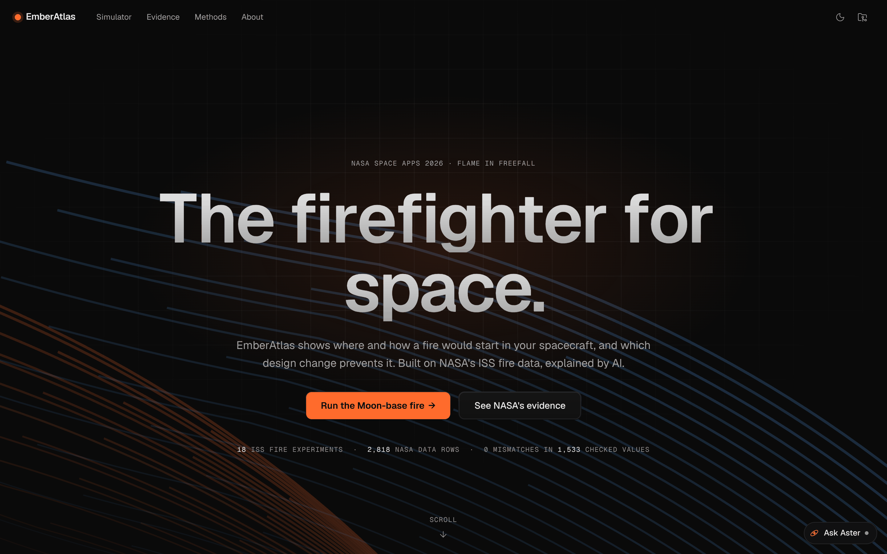
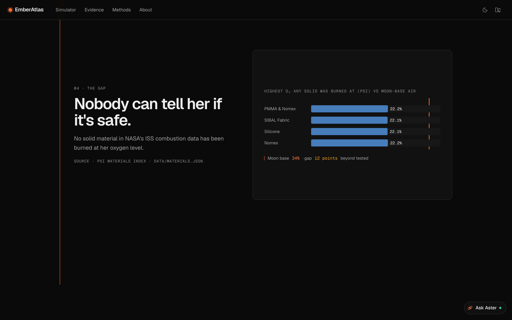
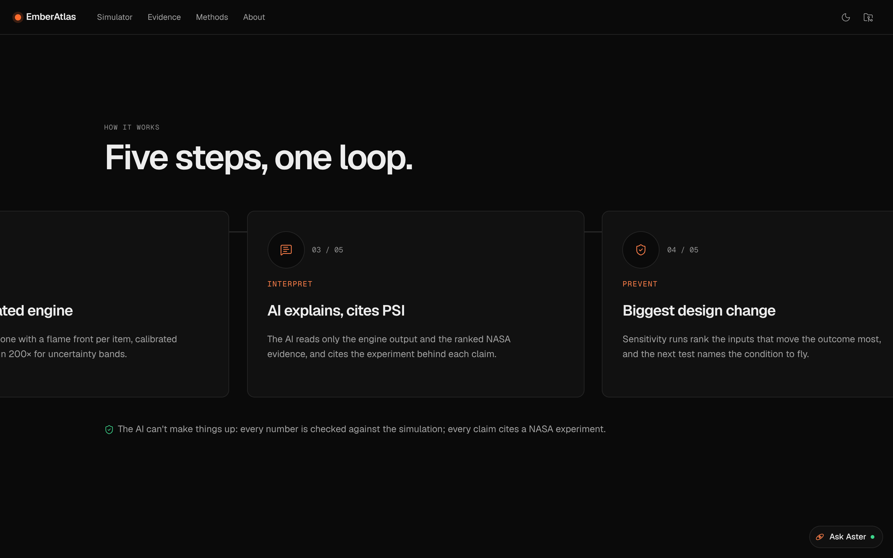
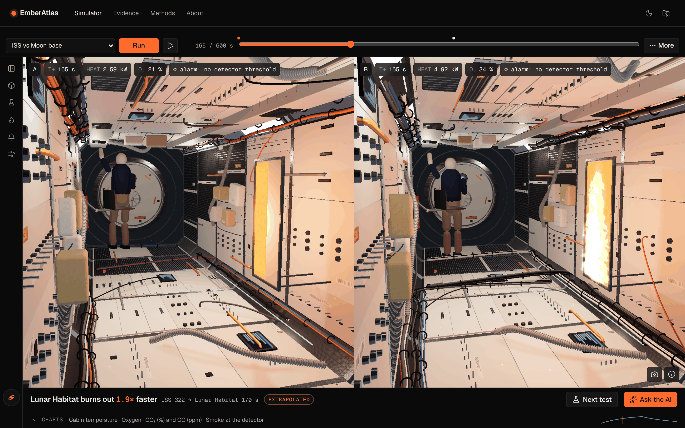
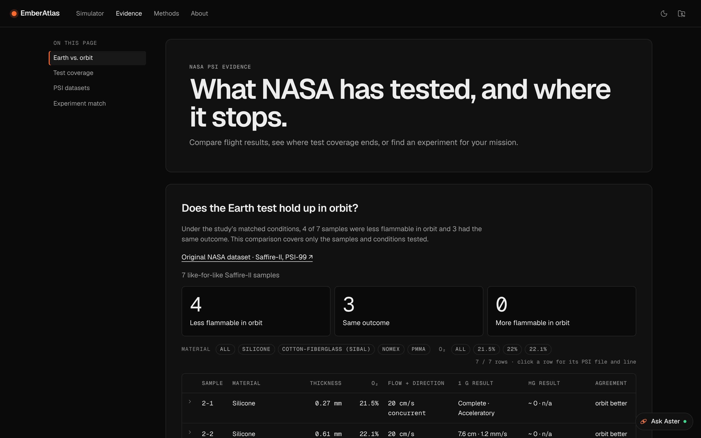

# EmberAtlas: the firefighter for space
It shows where and how a fire would start in your spacecraft, and which design change prevents it. Built on NASA's ISS fire data, explained by AI. NASA Space Apps 2026 · Flame in Freefall.

**Live app: https://flame-in-freefal.vercel.app**

**Find · Explain · Prevent** (numbers from `web/scripts/engine-check.ts`, see `docs/DEMO_SCRIPT.md`): the same SAFFIRE SIBAL fabric burns in an ISS cabin and a 34 % O₂ / 56.5 kPa / 1/6 g Moon-base cabin with the same response (crew detects at 30 s, fan off, 2 kg CO₂ 30 s later: design inputs, not NASA measurements). **ISS:** cutting the fan puts the fire out at 30 s. **Moon:** the fire outlasts the CO₂ and burns the whole sample by 171 s (peak heat 4 900 W vs 2 580 W). **Prevent:** a deterministic design review ranks the fixes (no AI needed); on the unfixed Moon cabin (`lunar-design-review`) fix #1 is "the extinguisher never fires: give it an alarm path". Then the app names the next test to fly. Earth test vs orbit: in SAFFIRE-II (PSI-99) like-for-like samples, none burned worse in orbit than in the 1 g test (7 samples, small n); no solid in PSI was burned above 22.2 % O₂.
**Findings** (all computed from `web/data`, shown on `/` and `/evidence`): 1. **Earth test vs orbit:** in SAFFIRE-II (PSI-99) like-for-like samples, none burned worse in orbit than in the 1 g test (currently 7 samples: 4 less flammable, 3 the same; small n). 2. **Where the evidence stops:** no solid in PSI was burned above 22.2% O₂ (`web/data/materials.json`); a lunar habitat breathes 34% at 56.5 kPa. ACME BRE (PSI-20) is the only flight data at exploration atmospheres, and it is a gas burner emulating solids. 3. **Beyond it:** the simulator runs the lunar cabin; every out-of-envelope result carries an EXTRAPOLATED badge and the app proposes the next test to fly.

**Simulator (3D):** the cabin view is a procedural, illustrative lab-module interior in which every fire-related visual (flame, char, fire light, smoke, alarm, fan, agent) is driven only by the engine frame via `web/components/sim/scene3d/frame.ts`; Elevation and Section remain as the 2D schematic, and the SVG is the fallback without WebGL. Keys: R run · C charts · F fullscreen · 1–4 camera presets · `?present=1` for a chrome-less demo run.

  

**Routes:** `/` story · `/simulator` (presets: Saffire replay; Same fabric: ISS vs Lunar Habitat; Moon base: find the gaps; Lunar Habitat: tune the response) · `/evidence` (Earth vs orbit, where the evidence stops, mission-to-experiment match) · `/methods` · `/about`.

**Run:** `pnpm -C web install` · `pnpm -C web dev` · `pnpm -C web test` · `pnpm -C web build`. Set `OPENAI_API_KEY` as a server-side env var (never `NEXT_PUBLIC_`, never committed); without it the AI panels say so and everything else works.

**Data:** 2,818 PSI table rows with accession + file + line provenance from 18 accessions (`web/data/psi/tables_index.json`): PSI-10 327 · PSI-20 18 · PSI-22 32 · PSI-23 18 · PSI-25 129 · PSI-26 122 · PSI-39 87 · PSI-47 2 · PSI-68 8 · PSI-69 274 · PSI-98/99/100 13 · PSI-101 109 · PSI-102 8 · PSI-107 469 · PSI-142 8 · PSI-159 1,194. Plus PSI-100 Saffire-III cabin telemetry for the replay.

**Validation (honest, one line each):**
- FLEX cross-check (PSI-69 table vs NASA/TP-2015-216046): 0 mismatches in 1,533 values (`web/data/psi/flex_crosscheck.json`).
- Held-out FLEX burning-rate constant K: MAPE 13.3%, n = 66 (`web/data/validation/droplet_K.json`).
- Flame spread on held-out SIBAL (Saffire-III): 29.3% error, n = 1 (`web/data/params/spread.json`). One training sample, one test sample.
- Saffire replay is a cabin-scale sanity check only (T RMSE ~6 K, P MAPE ~0.2%): a sample-size fire barely changes the cabin; it does not test flame-spread physics.

**Limitations:** one well-mixed cabin zone; 1D spread per item; partial gravity (1/6 g) is estimated between µg and 1 g, never measured, and NASA's FM2 lunar-gravity tests show some materials burn more readily at lunar g than at either, so it may be non-conservative; cabin heat loss and smoke are theory-only; small n everywhere. Not for flight certification. Details: `/methods#limitations`, `docs/VALIDATION.md`.

**Use of AI:** Claude Code (Anthropic) wrote the code under human direction and review. At runtime the OpenAI API powers the scenario builder, run interpretation and the experiment-match explanation, grounded on engine output and PSI rows, with a numeric guard (`web/lib/ai/guard.ts`). No AI-generated images.

**Docs:** `docs/SUBMISSION.md` · `docs/PITCH.md` · `docs/STATUS.md` · `docs/VALIDATION.md` · `CREDITS.md`. **License:** MIT (`LICENSE`).

## AI
- **The AI fire engineer:** *Build with AI* (simulator) interviews you (one prompt, ≤ 4 follow-ups, review), builds the cabin from NASA atmospheres and PSI materials only, ignites it in 3D; after each run it streams a 3-sentence briefing, ranks fixes you can *Apply & re-run* (A/B compare), and answers questions; what-ifs (“O₂ to 21 %?”) re-run the engine. Aster is the same AI site-wide.
- **Thinking you can trust:** the trail shows only real server/worker steps (reading evidence, engine run, fix ranking, numeric check, citations), streamed over SSE; no timers.
- **Guard:** every number in an answer must appear in engine/tool output (`web/lib/ai/guard.ts`), PSI ids must be in the evidence list; failures are stripped and flagged.
- **Offline fallback:** with no `OPENAI_API_KEY` (server-side only) the rule-based parser, fixed questions, engine summary and catalog search run the same UX, marked “offline mode”; runs with no flame show why (`web/lib/sim/noFire.ts`) with a one-click fix.
- Screenshots: [interview](docs/screenshots/ai-interview.png) · [thinking](docs/screenshots/ai-thinking.png) · [briefing](docs/screenshots/ai-briefing.png) · [fix](docs/screenshots/ai-fix.png)

## Design

- **Type:** Geist Sans for UI/headings (600, −0.04em at display sizes) and Geist Mono for numbers, labels and data (`tabular-nums`), loaded locally from the `geist` package.
- **Tokens:** dark-first palette in `web/styles/tokens.css` (#0A0A0A / #111 / #171717 surfaces, #262626 hairlines, ember #FF6B2C for the one primary action and live state, oxygen blue #5AA9FF for ISS/baseline series), mapped to shadcn variables and Tailwind colours.
- **Structure:** shadcn layout (`web/components.json`, `cn()` in `web/lib/utils.ts`); primitives live in `web/components/ui/*`, product components in `sim/`, `landing/`, `evidence/`.
- **Motion:** `motion/react`, 150–250 ms ease-out for UI, 600–900 ms scroll reveals on the landing, springs for emphasis; sticky sections use plain `position: sticky` with explicit heights.
- **Reduced motion:** `prefers-reduced-motion` renders final states (no letter reveal, static streamlines, no marquee or loops).

| Landing hero | Sticky story | How it works |
|---|---|---|
|  |  |  |

| Simulator | Evidence |
|---|---|
|  |  |
